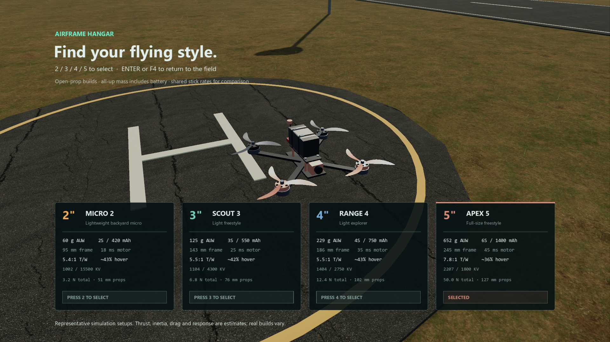

# Vector Flight Lab

**A physics-based drone simulator in Godot, with an Android phone as your touch radio.**

[](https://github.com/rasingollam/DroneSimulator/actions/workflows/checks.yml)
[](LICENSE)
[](https://godotengine.org/)

Practice throttle, yaw, pitch and roll in one outdoor training field. Fly with the keyboard or use two simultaneous touch sticks on your Android phone while watching the PC screen.


> **Project status:** working practice prototype. The aircraft uses engineering approximations, not measured parameters from a particular real drone. This is not a validated digital twin. Android installation, rendering, multitouch performance and haptic feel still need physical-device validation.

## Features

- Selectable **2-, 3-, 4- and 5-inch open-prop drones**, each with its own mass, inertia, thrust, drag, collision dimensions and motor response.
- Four independent motors applying thrust and reaction torque to a rigid body at 240 physics ticks per second.
- Motor spool response, quadratic drag, gravity, wind/gusts, contacts and impact-triggered motor cutoff.
- **Angle** self-leveling and **Acro** body-rate modes, with FPV and chase cameras.
- Textured field, HDR sky/reflections, wind-animated grass and pine foliage, smooth highlands, a flyable curved-roof hangar, service buildings and training obstacles. Environment photographs are CC0 assets from Poly Haven; see [credits](THIRD_PARTY_NOTICES.md).
- Full-screen view with minimal, instrument and hidden HUD modes; translucent bottom-center stick indicators.
- Lightweight **Android controller** with persistent throttle, two-finger input, telemetry and a round-trip delay display.
- Optional haptic cues for stick pickup, neutral crossings and travel limits.
- Local Wi-Fi pairing, acknowledged commands, stale-packet rejection and lost-link pause/disarm.

## Run the simulator

Install the **standard Godot 4.5.1 editor** or a compatible later Godot 4 release. No C#, addons, external art downloads or paid dependencies are needed. The verified baseline is Godot 4.5.1 on Windows; other platforms have not been validated.

```bash
git clone https://github.com/rasingollam/DroneSimulator.git
cd DroneSimulator
```

Import **`project.godot`** into Godot and press **F5**. If Godot is on your PATH, you can instead run:

```bash
godot --path .
```

On Windows, `Launch.cmd` uses `godot` on PATH, or an optionally supplied portable engine in `tools/`. **Engine binaries, Android SDKs and signing keys are not included in the repository.**

The simulator opens full screen, disarmed, with a clear view. **F1** opens the guide; **F2** opens pairing; **F3** cycles HUD modes; **F4** opens airframe comparison; **F11** toggles full screen. The upgraded visuals use Forward+ (Vulkan); `Launch-low-graphics.cmd` or `godot --path . --rendering-method gl_compatibility` provides a reduced-effects OpenGL fallback.

## Choose your drone

Press **F4** while disarmed, choose with **2 / 3 / 4 / 5**, and press **Enter** to return. The rotating preview shows the selected physical-size model and its specifications. Switching resets the aircraft and circuit; it never arms automatically. Android controller 1.2 also includes an **AIRFRAME** button.

| Build | Ready-to-fly mass | Pack | Approx. hover | Intended comparison |
| --- | --- | --- | --- | --- |
| 2-inch MICRO | 60 g | 2S 420 mAh | 43% | Light backyard micro |
| 3-inch SCOUT | 125 g | 3S 550 mAh | 42% | Light freestyle |
| 4-inch RANGE | 229 g | 4S 750 mAh | 43% | Light explorer |
| 5-inch APEX | 652 g | 6S 1400 mAh | 36% | Full-size freestyle |

These are representative builds, not brand replicas or a claim that every quad of that size flies the same. [Profile data, sources and estimated parameters](docs/DRONE_PROFILES.md) explain the basis and limits. Shared stick rates allow comparisons without arbitrary sensitivity changes.



## Fly with your Android phone

**[Download the controller APK](https://github.com/rasingollam/DroneSimulator/releases/latest/download/VectorController.apk)** · [Releases](https://github.com/rasingollam/DroneSimulator/releases) · [Installation and troubleshooting](dist/INSTALL.md)

The APK controls the PC simulator; it does not run the 3D world on the phone. Android 6.0+ and a multitouch screen are required.

1. Install `VectorController.apk` on your phone. Android may ask you to allow installation from your browser or file manager.
2. Connect PC and phone to the **same private local network**. Avoid guest Wi-Fi/client isolation.
3. Start the simulator and press **F2**.
4. In the app, enter the displayed PC IPv4 address and six-digit pairing code.
5. Tap **Start / Resume**, then **Arm**. Gently raise throttle above the **HOVER** value for your selected airframe (about 36% for the default 5-inch build).

| Stick | Vertical | Horizontal | On release |
| --- | --- | --- | --- |
| Left | Throttle | Yaw | Throttle stays; yaw centers |
| Right | Pitch | Roll | Both center |

Movement is relative to where each thumb engages, so touching or re-gripping does not jump throttle. A dead zone and response curve soften center control. PC stick indicators show received commands before aircraft smoothing.

**Haptics:** a short tap confirms pickup, a light tick marks neutral, and a limit bump marks full axis travel or zero/full throttle. Use **HAPTICS ON/OFF** to toggle. Enable Android touch vibration if needed. Strength depends on the phone; vibration affects the whole device, not individual thumbs.

If the app closes, backgrounds, or stops sending valid packets for **500 ms**, the PC pauses and disarms. Reconnecting requires neutral sticks and zero throttle, then deliberate resume and arming. **K** returns to keyboard control; **F2** enables phone pairing again.

Allow Godot on **Private networks** if Windows Firewall asks. Control uses **UDP 42424**. No cloud service or router port forwarding is needed. Pairing traffic is **not encrypted**; use a trusted private LAN and read [SECURITY.md](SECURITY.md).

For optional Wi-Fi APK transfer, install Python 3 and run `Install-on-phone.cmd`, or `python android-controller/serve_apk.py`. Open the displayed local address on the phone. The helper uses TCP 8765, serves only the APK and installation page, and should be stopped after transfer. USB file transfer also works.

## Keyboard and display controls

| Key | Action |
| --- | --- |
| **W / S** | Increase / decrease persistent throttle |
| **A / D** | Yaw left / right |
| **↑ / ↓** | Pitch forward / back |
| **← / →** | Roll left / right |
| **Space** | Arm / disarm; throttle returns to zero |
| **H** | Set level-hover power; no altitude hold |
| **Tab** | Angle / Acro |
| **C** | Chase / FPV camera |
| **[ / ]** | Adjust FPV camera tilt |
| **B** | Calm / light wind / breezy |
| **R** | Return to pad, disarmed; restart circuit attempt |
| **Escape** | Pause / resume |
| **F1 / F2** | Guide / phone pairing |
| **F3** | Minimal display → full instruments → hidden HUD |
| **F4 / 2–5** | Airframe comparison / select size while disarmed |
| **F11** | Full screen / windowed |
| **K** | Disconnect phone and use keyboard |
| **M** | Mute / unmute motors |

Hold W gently past hover power, then release to keep that setting. Tap S to descend. Small pitch/roll inputs are easier to control than long holds. Some keyboards cannot register all simultaneous key combinations.

**Angle** commands up to 30° bank/pitch and self-levels on release. **Acro** commands rotation rates; releasing the stick stops rotation while retaining tilt. Neither mode holds altitude or position. Banking redirects thrust, so maintaining height requires additional throttle.

## Training circuit

The teal gate is next. Pass through its opening in the forward direction, then continue in numerical order. The timer starts at gate 1; a lap ends when you return through gate 1 after gates 2–7. Hard impacts cut motor power; reset to retry. Height telemetry references the flat field datum, not the top of every obstacle.

## Physics and realism

Each airframe is a `RigidBody3D` with profile-specific mass/inertia, motor lever arms, drag and thrust limits. A body-rate PID controller mixes commands into four motor forces; rotor speed has a profile-specific 18–45 ms response and thrust is proportional to speed squared. Ground effect and rotor-plane drag use bounded engineering approximations. Gravity and contact response remain engine-driven.

Detailed blade aerodynamics, propwash/vortex-ring state, battery sag, frame flex, RF latency and structural damage are not modeled. Frame/battery colliders are simplified. Parameters are not calibrated against real flight logs. Touchscreens cannot reproduce spring tension or physical-stick muscle memory.

See [Physics model and parameters](docs/PHYSICS.md) for coefficients and limitations.

## Development and checks

Install **Python 3**, **Godot 4.5.1** and a **JDK** for the Java tests. No Python packages are required.

```bash
python tests/run_checks.py --godot /path/to/godot
```

The runner checks project import, gravity/hover/attitude behavior, keyboard integration, the real UDP receiver, control math, haptic detection, APK checksum and restricted APK transfer. GitHub Actions runs the same checks. Physical Android input and vibration require manual validation.

The Android app is plain Java, with no external app libraries or Gradle dependencies. Build on Windows using **OpenJDK 17**, **SDK platform 35** and **build-tools 35.0.1**:

```powershell
.\android-controller\build.ps1 -Jdk 'C:\path\to\jdk-17' -Sdk 'C:\path\to\android-sdk'
```

See [Development and build instructions](docs/DEVELOPMENT.md). Keep your generated development signing key private. Builds signed by another publisher cannot update the distributed APK in place.

## Project layout

```text
scenes/                  Main Godot scene
scripts/                 Aircraft, world, cameras, HUD and phone receiver
android-controller/      Android source, build script and transfer helper
dist/                    APK, SHA-256 checksum and phone setup guide
tests/                   Physics, input, network and artifact checks
docs/                    Physics/development notes and screenshot
```

## Contributing and license

Issues and focused pull requests are welcome; see [CONTRIBUTING.md](CONTRIBUTING.md). For vulnerabilities, see [SECURITY.md](SECURITY.md). See [CHANGELOG.md](CHANGELOG.md) for changes.

Code and generated geometry are licensed under the **[MIT License](LICENSE)**. The included photographs/HDRI are CC0; see [THIRD_PARTY_NOTICES.md](THIRD_PARTY_NOTICES.md) and `assets/sources.json`. Godot, Android tools and Java are separate dependencies with their own licenses and are not redistributed here.
